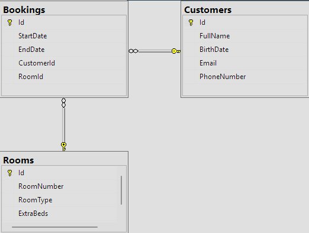

# Hotel Booking App

A console app for managing a small hotel's rooms, guests and bookings. It is written in C# on .NET 10 and stores its data in SQL Server through Entity Framework Core.

The app is built around a set of booking rules that it enforces before anything is saved. A room can never be booked twice for overlapping dates, and a guest or room with upcoming bookings can't be deleted.

## Features

- **Bookings:** create, edit and delete bookings. Find them by ID, by date (who is staying on a given day), by room number or by guest.
- **Guests:** register guests and edit their details. Search by ID, name, birth date, email, phone number or booking.
- **Rooms:** add and edit rooms (single or double, size in m², extra beds). List the rooms that are free between two dates.
- **Navigation:** the whole app runs on the arrow keys. Long lists are split into pages that you move between with ←/→, Enter selects and Esc or Backspace goes back.

## Business rules

The rules live in the service layer (`Services/`), so every menu goes through the same checks:

| Rule | Where |
|---|---|
| A room can't have two bookings with overlapping dates. Editing a booking ignores the booking itself. | `BookingService.IsRoomAvailable` |
| The end date must be after the start date, and a booking can't start in the past. | `BookingService` |
| Guests must be at least 18, and email and phone number must be unique. Unique indexes in the database back this up. | `CustomerService`, `ApplicationDbContext` |
| Room numbers are unique. Single rooms get no extra beds, rooms under 25 m² get none, and double rooms under 30 m² get at most one. | `RoomService.ValidAmountOfExtraBeds` |
| A room or guest with a current or future booking can't be deleted. | `RoomService`, `CustomerService` |

Each operation returns a validation result object (`BookingValidationResult`, `RoomValidationResult`, `CustomerValidationResult`) that lists every rule that failed. The UI can then show all the problems at once, without throwing exceptions.

## Database model



The schema is code-first, with EF Core migrations in `Migrations/`. `HotelBookingAppQuery.sql` holds some example reporting queries, such as guests ranked by number of bookings, guests aged 65 or over, and bookings sorted by length of stay.

## Tech

- C# / .NET 10 console app
- Entity Framework Core 10 (code-first, migrations, LINQ)
- SQL Server
- [Bogus](https://github.com/bchavez/Bogus) for test data
- Microsoft.Extensions.Configuration for reading the connection string from `appsettings.json`

## Project structure

```
HotelBookingApp/
  Program.cs        startup: migrate the database, seed it, wire up services and flows
  App.cs            the main menu loop
  Models/           Booking, Customer, Room (EF Core entities)
  Data/             ApplicationDbContext and the Bogus seeder
  Services/         business rules and database access, one service per entity
  Flows/            the steps of each task (create, read, update, delete)
  Menus/            the menus for each part of the app
  Utilities/        a reusable, paginated ConsoleMenu<T>, input helpers and printers
  Migrations/       EF Core migrations
```

## Running it

You need the [.NET 10 SDK](https://dotnet.microsoft.com/download) and a SQL Server instance running locally. The app connects to `localhost` with Windows authentication. To use another server, change `DefaultConnection` in `HotelBookingApp/appsettings.json`.

```bash
dotnet run --project HotelBookingApp
```

You can also open `HotelBookingApp.slnx` in Visual Studio and press F5. On first start the app creates the `HotelBookingAppDb` database, applies the migrations and fills it with 150 guests, 40 rooms and 100 bookings of test data.

If the build fails with `NETSDK1004` (missing `project.assets.json`), run `dotnet restore` first.
